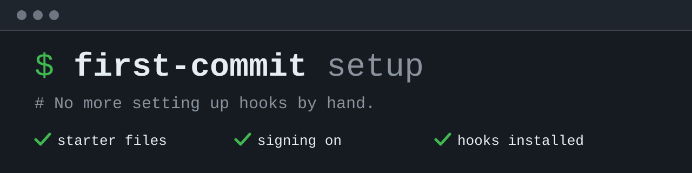

# first-commit

**Start a new Git project in one command, with hooks, signing, and starter
files already in place.**

Every new project needs the same groundwork: starter files, commit signing,
Git hooks, and a secret scanner. first-commit sets it all up in one command.
From then on, its hooks stop a secret, a private value, or an unsigned commit
on your machine, before it becomes history.

Install it into its own folder, then start a project:

```sh
python3 -m venv /path/first-commit && /path/first-commit/bin/python -m pip install 'first-commit[setup] @ git+https://github.com/amrendra18/first-commit.git@v0.4.0'
mkdir my-project && cd my-project && /path/first-commit/bin/first-commit setup
```

Setup shows its plan and asks before it changes anything.
`/path/first-commit` is any folder for the tool. Check the
[requirements](#requirements) first.

## Contents

1. [What it does](#what-it-does)
2. [Requirements](#requirements)
3. [Install](#install)
4. [Start a project](#start-a-project)
5. [Set up a clone](#set-up-a-clone)
6. [Daily use](#daily-use)
7. [Project settings](#project-settings)
8. [Stop and recover](#stop-and-recover)
9. [Upgrade](#upgrade)
10. [Remove](#remove)
11. [Learn more](#learn-more)
12. [License and credits](#license-and-credits)

## What it does

One `setup` run in an empty folder:

1. creates starter files: `README.md`, `AGENTS.md`, `.gitignore`, a commit
   template, and the project policy file (`.repo-policy.json`);
2. turns on SSH commit signing;
3. installs Gitleaks (a secret scanner) and Git hooks through pre-commit (a
   tool that runs Git hooks), pinned to one commit of this
   repository.

From then on, the hooks check every commit and push:

| When | What is checked |
| --- | --- |
| Commit | Secrets, keys and tokens, home paths, unapproved emails, your private values, forbidden paths, dotenv files, `@no-commit` markers, text hygiene, required documents |
| Commit message | Format and review sections, secrets, private values, identity, and signing |
| Push | Secrets and private values in the pushed commits, their messages, and their tags |

A finding never prints the text it matched. It prints a `fix:` line instead.

The hooks run on your machine, so `git commit --no-verify` skips them. Shared
repositories still need server-side rules; see [SECURITY.md](SECURITY.md).

## Requirements

1. macOS or Linux, Git, and Python 3.11 to 3.14. On Windows, use WSL (Windows
   Subsystem for Linux). Elsewhere, every command stops with exit 3.
2. pre-commit 3.2.0 or newer, running on Python 3.11 to 3.14. Install it with
   `pipx install --python python3.13 pre-commit`, or `brew install pre-commit`
   on macOS, and check it with `pre-commit --version`. Every clone needs it.
3. An SSH signing key. Create one with `ssh-keygen -t ed25519`. GPG signing is
   not supported. Setup reads only the public key, the file ending in `.pub`.
4. A public Git author name and email.
5. Network access to GitHub, GitHub Releases, and a Python package index.
6. At most 10,000 files, in a standard repository root (no linked worktree or
   submodule).

## Install

The quick start installs release v0.4.0 over HTTPS. To check the release
first, compare the commit SHA this prints with the
[release page](https://github.com/amrendra18/first-commit/releases/tag/v0.4.0).
If they differ, do not install.

```sh
git ls-remote https://github.com/amrendra18/first-commit 'v0.4.0^{}'
```

To install over SSH, with an SSH key on your GitHub account:

```sh
python3 -m venv /path/first-commit
/path/first-commit/bin/python -m pip install \
  'first-commit[setup] @ git+ssh://git@github.com/amrendra18/first-commit.git@v0.4.0'
```

The rest of this page calls the tool through a variable. Set it in each new
shell:

```sh
FIRST_COMMIT=/path/first-commit/bin/first-commit
"$FIRST_COMMIT" version
```

The last command prints `0.4.0`. `--version` does the same.

## Start a project

```sh
mkdir my-project && cd my-project
"$FIRST_COMMIT" setup --dry-run
"$FIRST_COMMIT" setup
"$FIRST_COMMIT" doctor
```

1. The dry run prints the plan and changes nothing
   ([sample output](verify/features/first-run.md#proof)).
2. Setup asks for your name, email, and public-key path, then asks before it
   applies the plan (`--yes` skips the question). It saves your
   identity for later clones on this machine and ends with
   `Verification: passed`. Other options are in
   [ARCHITECTURE.md](ARCHITECTURE.md#setup-options).
3. The first `doctor` prints `WARN doctor` with
   `git.signature-verification-trust` and exits 0, because this checkout does
   not trust your key yet. To trust it, run the command its `fix:` line prints:

```sh
FIRST_COMMIT_TRUST_SELF=1 pre-commit run first-commit-setup --hook-stage manual
```

### Make the first commit

Edit `README.md` and `AGENTS.md` for your project and delete their
`@no-commit` lines; the hooks block a commit while one remains. With
`--docs full` or `--license`, also stage `PRD.md`, `CONTRIBUTING.md`,
`SECURITY.md`, or `LICENSE`.

```sh
git add README.md AGENTS.md .gitignore .editorconfig .gitattributes .gitmessage .pre-commit-config.yaml .repo-policy.json
git commit
```

Git opens the template `.gitmessage`. Keep its `<type>(<scope>)!: <subject>`
line, fill in the four sections, and write `Not run: <reason>` when no test
applies. Example message:

```text
docs: start the project

Why:
- The project needs its entry point and agent rules.

Changes:
- Add the starter files that first-commit setup created.

Test Plan:
- Not run: the commit holds documents and configuration only.

Risks:
- Low: no code yet.
```

The hooks print `Passed`, and Git signs the commit.

## Set up a clone

A clone needs pre-commit only. In the clone, run:

```sh
pre-commit install
pre-commit run first-commit-setup --hook-stage manual
```

The second command sets the clone's identity and signing from the identity
setup saved on this machine, and installs Gitleaks. Without a saved identity,
it prints the command to run instead. Prefix it with
`FIRST_COMMIT_TRUST_SELF=1` to trust your own key in the clone too.

## Daily use

To check on demand:

```sh
"$FIRST_COMMIT" check   # working tree, staged files, and whole history
"$FIRST_COMMIT" doctor  # identity, signing, hooks, and scanner
```

In a clone, run them through pre-commit:

```sh
pre-commit run first-commit-check --hook-stage manual --all-files
pre-commit run first-commit-doctor --hook-stage manual --all-files
```

Both are read-only and offline. Add `--format json` for JSON.

## Project settings

1. **Private values.** List words that must never be committed, such as your
   employer or your home town, one per line in the ignored
   `.local/first-commit/private-values.txt`.
2. **Project facts.** `.repo-policy.json` holds approved public emails,
   forbidden paths, and reviewed exceptions. No field turns off a check.
   Stage an edit to it before the commit that needs it. The fields are in
   [ARCHITECTURE.md](ARCHITECTURE.md#project-policy-file).
3. **False positives.** A reviewed Gitleaks false positive goes in
   `.gitleaksignore`; see
   [Gitleaks exceptions](ARCHITECTURE.md#gitleaks-exceptions).

## Stop and recover

A failed setup undoes its changes, and each finding ends with a `fix:` line.
For the rest:

1. **Install fails with `No matching distribution found`.** `python3` is
   older than 3.11. Install again with `python3.13`.
2. **Clone setup or a commit fails with
   `No matching distribution found for setuptools`.** pre-commit runs on a
   Python older than 3.11. Run `python3 -m pip uninstall pre-commit`, then
   `pipx install --force --python python3.13 pre-commit`, then
   `pre-commit install` in the clone, and retry.
3. **Setup conflict.** The error names the file or setting and how to resolve
   it. An existing `.gitignore` must ignore `.local/`. For an existing
   `.pre-commit-config.yaml`, see
   [Hook file rules](ARCHITECTURE.md#hook-file-rules).
4. **Wrong identity or key.** Run the commands below in the checkout. Then
   correct or delete `~/.config/first-commit/identity.json`
   (`$XDG_CONFIG_HOME/first-commit/identity.json` when `XDG_CONFIG_HOME` is
   set) and run setup again.

   ```sh
   rm .local/first-commit/contributor.json
   git config --local --unset user.name
   git config --local --unset user.email
   git config --local --unset user.signingkey
   ```

5. **Scanner download failed.** Check access to GitHub Releases, or place a
   trusted Gitleaks 8.30.0 binary at `.local/bin/gitleaks`.
6. **Hook environment failed.** Read pre-commit's log before a new run
   replaces it: `~/.cache/pre-commit/pre-commit.log`, or
   `$PRE_COMMIT_HOME/pre-commit.log`, or
   `$XDG_CACHE_HOME/pre-commit/pre-commit.log` when only `XDG_CACHE_HOME` is
   set. Check the hook URL and network access, then rerun setup.
7. **Too many files.** `check` and the pre-push hook stop with exit 4 and
   `File count exceeds the limit of 10,000 paths.` Add generated folders such
   as `node_modules/` to `.gitignore`, untrack them with
   `git rm -r --cached <folder>`, and retry.
8. **A secret in a commit or tag message.** Revoke it with its provider
   first. Then reword it as
   [Messages already pushed](ARCHITECTURE.md#messages-already-pushed) says.

## Upgrade

1. Install the new tag into the tool folder, as in [Install](#install).
2. In the project, run
   `pre-commit autoupdate --freeze --repo https://github.com/amrendra18/first-commit`.
   Use the address your `.pre-commit-config.yaml` names. It pins the new
   tag's commit SHA.
3. Review and commit `.pre-commit-config.yaml`. Each clone installs the new
   hooks on its next run.

## Remove

To undo setup in one checkout, run the commands below. Check
`git config --local --list` first, because the loop also removes values you
set yourself.

```sh
pre-commit uninstall
for key in user.name user.email user.signingkey gpg.format commit.gpgsign \
  tag.gpgsign user.useConfigOnly commit.template gpg.ssh.allowedSignersFile; do
  git config --local --unset-all "$key"
done
rm -rf .local/first-commit .local/bin/gitleaks
```

To stop using the hooks, delete the first-commit entry from
`.pre-commit-config.yaml` and commit. When no setup is running, delete the
lock file setup leaves with `rm .git/first-commit-setup.lock`. To remove the
tool, delete its folder and the saved identity file from
[Stop and recover](#stop-and-recover), item 4.

## Learn more

1. [ARCHITECTURE.md](ARCHITECTURE.md): how it works, its security rules,
   limits, output, and policy fields.
2. [verify/features](verify/features/README.md): what the end-to-end tests
   prove.
3. [CONTRIBUTING.md](CONTRIBUTING.md): build, test, and propose a change.
4. [SECURITY.md](SECURITY.md): report a vulnerability.

## License and credits

Copyright 2026 Amrendra Kumar.

Apache-2.0, see [LICENSE](LICENSE). The software is provided as is, without
warranty; see sections 7 and 8 of the license.

first-commit stands on [pre-commit](https://pre-commit.com) and
[Gitleaks](https://github.com/gitleaks/gitleaks), both MIT licensed. pip
installs pre-commit with first-commit, and setup downloads Gitleaks. This
repository contains neither.
